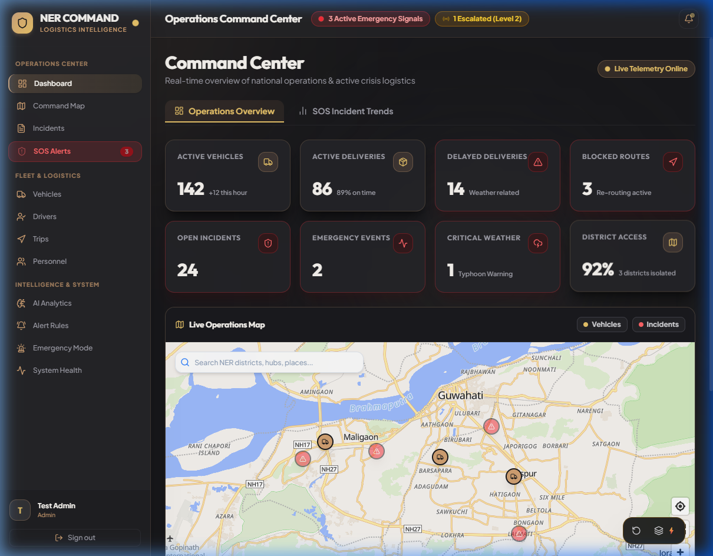
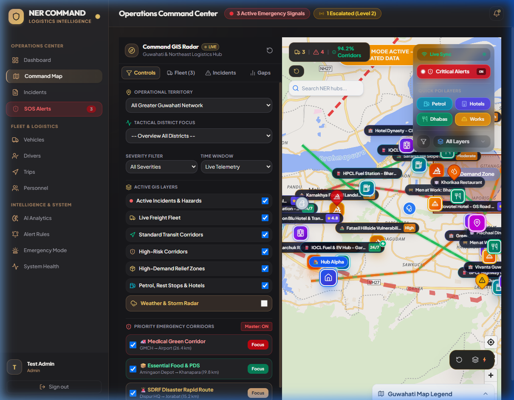
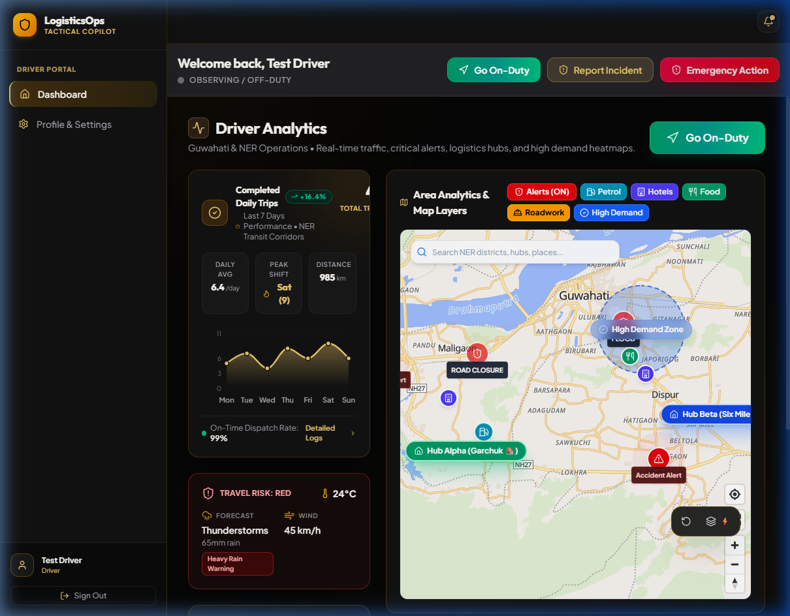
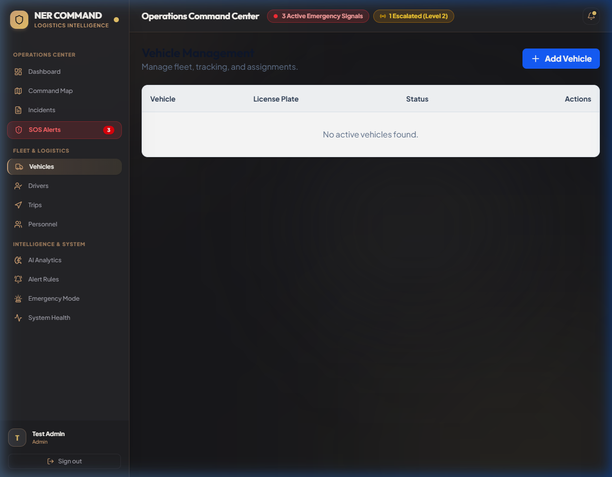
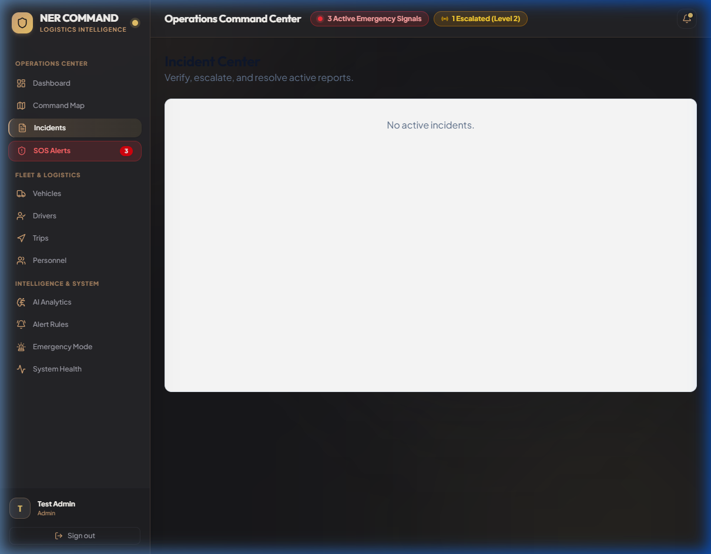
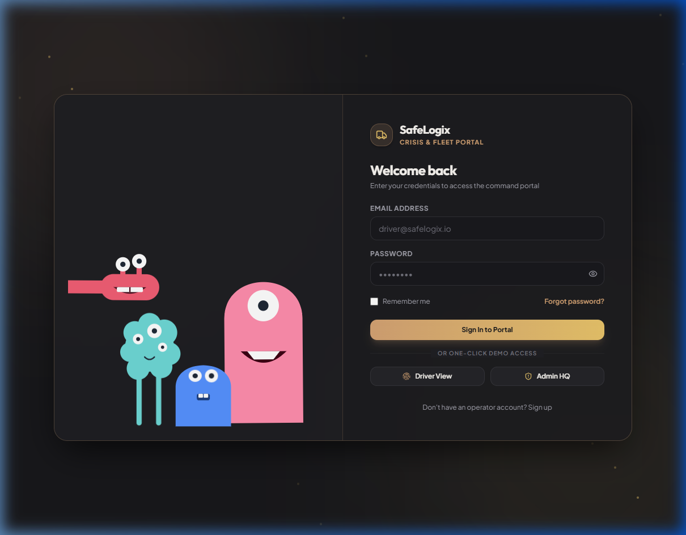

<div align="center">

# 🛡️ SafeLogix: Crisis & Fleet Intelligence Platform
### AI-Powered Smart Logistics & Accessibility Intelligence for North Eastern Region (NER)

[](https://sih-logistics-psi.vercel.app)
[](https://github.com/chinmoyy12/SIH-LOGISTICS-)
[](#license)
[](https://sih-logistics-psi.vercel.app)

<br />

**[🌐 Open Live Vercel Deployment](https://sih-logistics-psi.vercel.app)** &nbsp; | &nbsp; **[💻 View GitHub Repository](https://github.com/chinmoyy12/SIH-LOGISTICS-)**

</div>

---

## 📌 Overview

**SafeLogix** is a high-availability, real-time crisis logistics and accessibility intelligence platform engineered specifically for challenging terrains in the **North Eastern Region (NER)** of India. 

The platform integrates real-time **GIS spatial intelligence**, **predictive AI risk forecasting**, **tactical driver telematics**, and **emergency SOS dispatching** into a unified command dashboard for district officers, disaster management teams, and relief drivers.

---

## 📸 Application Preview

### 1. Operations Command Center (Admin View)


### 2. GIS Command Intelligence Map


### 3. Driver Field Portal & Vehicle Telematics


### 4. Fleet Management & Vehicle Registry


### 5. Tactical Incident Management & SOS Dispatch


### 6. Authentication & Role Gateway


---

## ✨ Key Features

### 🛡️ Admin Command Center
- **Live Fleet Metrics**: Real-time tracking of active vehicles, delayed deliveries, and blocked disaster corridors.
- **GIS Tactical Map**: MapTiler & MapLibre GL spatial layers visualizing floods, landslides, waterlogging, and emergency relief corridors.
- **Delay Intelligence**: Predictive route risk scoring factoring weather conditions, roadwork, and historical disruption points.
- **Emergency SOS Dispatch**: Live SLA tracking (180s threshold) with automated Level-2 escalation banners.

### 🚚 Driver Field Dashboard
- **Duty State Toggle**: One-touch On-Duty / Off-Duty synchronization.
- **Active Dispatch View**: Pickup depot, destination, ETA, cargo category, priority level, and remaining distance indicators.
- **Vehicle Telematics**: Engine status, battery health, fuel levels, operating temperature, and maintenance fault alerts.
- **Field Incident Reporting**: Instant report submission for landslides, road blockages, and flood hazards with photo upload proof and GPS location logging.

### 🤖 Predictive AI & Analytics
- **Disruption Forecasting**: Machine learning models predicting high-risk route closures (e.g. Route 7 Landslide Risk).
- **Weather Impact Mapping**: Heatmaps analyzing precipitation and road degradation impact across districts.

---

## 🛠️ Technology Stack

| Layer | Technologies Used |
| :--- | :--- |
| **Frontend Framework** | React 19, Vite 6, TypeScript |
| **Styling & Motion** | TailwindCSS v4, Lucide React, Motion |
| **State Management** | Zustand 5 |
| **GIS & Mapping** | MapLibre GL, MapTiler SDK, Turf.js, Supercluster |
| **Backend API** | Express 4, Node.js (tsx), Serverless Vercel Handlers |
| **Database & ORM** | PostgreSQL, Drizzle ORM, node-postgres |
| **Authentication** | Firebase Auth & Dev RBAC Tokens (`DEV_MOCK_TOKEN`) |
| **PWA & Offline** | Vite PWA Plugin, Workbox Service Worker |

---

## 🔐 Authentication & Roles

SafeLogix implements strict Role-Based Access Control (RBAC):

| Role | Access Scope | Landing Route |
| :--- | :--- | :--- |
| `driver` / `field_user` | Driver Field Dashboard, Vehicle Diagnostics, Incident Reporting, Profile Settings | `/driver` |
| `admin` / `super_admin` | Full Command Portal, GIS Intelligence Map, Fleet Management, Incident Dispatch, AI Analytics, System Health | `/admin` |
| `district_officer` | District-specific Command & Incident Management | `/admin` |
| `logistics_coordinator` | Fleet Dispatch & Trip Management | `/admin/trips` |

---

## 🚀 Quick Start (Local Development)

### 1. Clone Repository
```bash
git clone https://github.com/chinmoyy12/SIH-LOGISTICS-.git
cd SIH-LOGISTICS-
```

### 2. Install Dependencies
```bash
npm install
```

### 3. Start Development Server
```bash
npm run dev
```
Open [http://localhost:3000](http://localhost:3000) in your browser.

---

## 🌐 Production Deployment

The project is configured for one-click deployment on **Vercel**:

```bash
npm run build
vercel --prod
```

Live Production Deployment: **[https://sih-logistics-psi.vercel.app](https://sih-logistics-psi.vercel.app)**

---

## 📄 License
This project is licensed under the MIT License - see the [LICENSE](LICENSE) file for details.
